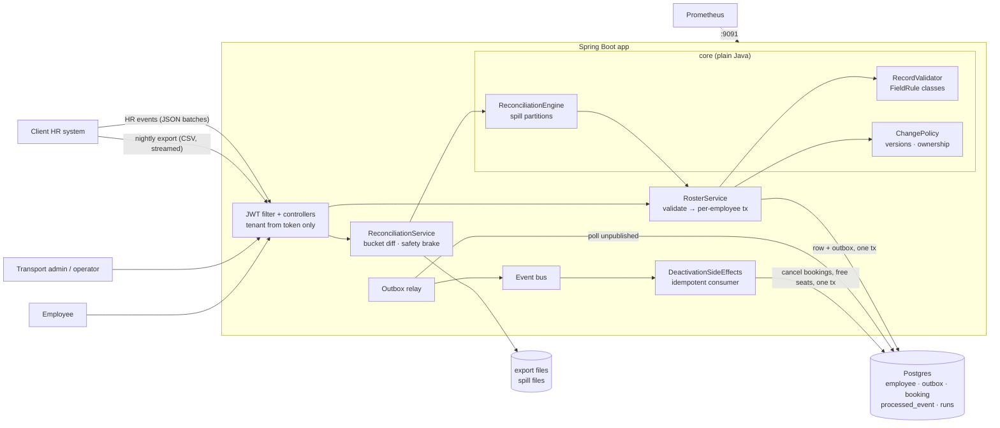

# Design note — HR Roster Sync (idempotent, out-of-order, self-healing)

## 1. Architecture



Layers: controller → service → repository (`RosterStore`, `BookingStore`, `CatalogStore`, `RunStore`), with a
Postgres and an in-memory implementation of each. The rules (`ChangePolicy`, `RecordValidator`,
`ReconciliationEngine`, `SafetyBrake`, `OutboxRelay`) are plain classes tested without Spring or a database.

**Data model.** `employee` (HR-owned fields + `hr_version`, `hr_source_time`, `hr_hash`; transport-owned fields +
`transport_version`; `bucket` and `digest` for the diff), `outbox` (change events), `booking`, `route`,
`processed_event` (idempotent consumers), `reconciliation_run`, `catalog` (office and shift codes per tenant).

## 2. The rules

**Idempotency key** = (tenant, employee id, HR version). **Version comparison** against the highest HR version
applied to that employee: greater → apply; equal and same content → `DUPLICATE` (no-op); equal and different
content → `CONFLICT` (the source reused a version; reported, not applied); smaller → `STALE` (ignored). If the
source only has timestamps, the version is the timestamp in epoch milliseconds.

**Why ignoring stale updates is correct:** HR events carry the *whole* HR-owned profile (snapshot semantics), so the
newest version already contains everything older ones said. Case-study example: v7 (transfer) arrives, then v6
(shift change) is ignored; the employee is in the new office with the v7 shift. A `DEACTIVATE` that arrives before its
`CREATE` leaves a tombstone with its version, so the late `CREATE` is correctly stale.

**Field ownership and the conflict rule.** HR owns name, email, phone, manager, office, shift and status; the
transport admin owns pickup point and special assistance. A change from one owner can only set that owner's fields;
the other owner's fields in its payload are ignored and listed in the response as `ignoredFields`. The two owners have
**separate version streams**: HR versions come from the source; transport edits use optimistic concurrency on
`transport_version` (409 if someone else edited first). So an HR update can never overwrite a transport field, and a
transport edit can never make an HR update look stale.

**Validation at the boundary.** Every field is checked by small `FieldRule` classes (pattern, catalog membership,
not-self); all errors of a record are reported as `{field, code}` — never the value. Each record is its own
transaction, so one bad record never fails the batch.

**Outbox.** The employee row and its change event are written in **one transaction** (Postgres) / one atomic commit
(in-memory). A relay publishes committed events in order and marks them published. A crash between commit and
publish only delays the event; a crash between publish and mark re-delivers it, and consumers de-duplicate on
`eventId` in the same transaction as their effects. Events carry ids, field names and versions — no personal data.

**Deactivation side effects.** The booking consumer receives `DEACTIVATED`, cancels the employee's future bookings
and releases their seats, and records the event id — all in one transaction.

## 3. Nightly reconciliation (bounded memory)

1. **Stream the file once.** Validate each row; XOR a 64-bit mix of (id, content hash) into its bucket's digest
   (4,096 buckets); append the row to one of 64 spill files on disk. Memory: 4,096 longs.
2. **Compare digests** with the store's (`SELECT bucket, bit_xor(digest) … GROUP BY bucket` — computed by Postgres).
   Equal digest = identical bucket, skipped without reading a row.
3. **Per partition**, load only the rows of differing buckets from the spill file and from the store, classify
   (new / changed / unchanged / missing) and write actions to an action file. Memory: one partition's differing
   buckets (≈ N/64 worst case; 5,194 rows on the 200k benchmark).
4. **Safety brake** (configurable): trip if missing ≥ 30% of active employees, the `#END rows=N` trailer is absent or
   wrong, the header is bad, or nothing is valid. If tripped: status `BRAKED`, an ALERT log line and a metric, and
   **nothing is applied** — not even updates — until an operator approves (re-runs the diff on current data and
   applies) or rejects.
5. **Apply** actions through the same idempotent, version-checked path as the live feed. Deactivations re-check that
   the employee has not changed since the export was taken. Re-running a file is therefore always safe, which is
   also how a crash mid-run is recovered.

Complexity: time O(N) to stream + O(rows in differing buckets) to compare + O(changes) transactions; memory
O(B + N/64); disk O(N). Measured: 200,000 rows in 2.1–2.8 s with a 512 MB heap (see the benchmark).

## 4. Hardest flow — HR deactivation through to freed seats

```mermaid
sequenceDiagram
    participant HR as HR system
    participant API as HrFeedController
    participant RS as RosterService
    participant DB as Postgres
    participant R as Outbox relay
    participant C as Booking consumer
    HR->>API: POST /hr/events [{DEACTIVATE E2 v2}]
    API->>RS: ingestBatch(tenant from JWT)
    RS->>RS: validate (field + code errors only)
    RS->>DB: BEGIN; pg_advisory_xact_lock(tenant/E2)
    RS->>DB: SELECT employee E2
    RS->>RS: ChangePolicy: v2 > v1 → APPLIED, DEACTIVATED
    RS->>DB: UPSERT employee; INSERT outbox(eventId); COMMIT
    API-->>HR: 200 {outcome: APPLIED}
    Note over RS,R: crash here? the event is in the outbox; the relay publishes it after restart
    R->>DB: SELECT … FROM outbox WHERE published_at IS NULL ORDER BY seq
    R->>C: publish(DEACTIVATED E2, eventId)
    C->>DB: BEGIN; INSERT processed_event(eventId) ON CONFLICT DO NOTHING
    alt already processed (redelivery)
        C->>DB: COMMIT (no-op)
    else first time
        C->>DB: cancel future bookings; release seats; COMMIT
    end
    Note over R,C: crash here? not marked → re-delivered → consumer no-ops
    R->>DB: UPDATE outbox SET published_at = now()
```

## 5. Failure modes

| What fails | What the user sees | How the system recovers |
|---|---|---|
| Same batch delivered twice | `DUPLICATE` per record, nothing changes | Idempotency key (tenant, id, version). Tested: replay of 200k records → 0 changes. |
| Updates out of order | Older ones `STALE` | Per-employee version check under the employee lock. |
| Bad data in a record | That record `REJECTED` with `{field, code}`; others applied | Boundary validation; per-record transactions. |
| Source reuses a version with new content | `CONFLICT` for that record | Not applied; counted in `roster_records_total{outcome="CONFLICT"}`. |
| Process crashes inside a transaction | Request fails | Rollback: neither row nor event. Sender retries; idempotent. |
| Crash after commit, before publish | Nothing (event delayed) | Event stays in the outbox; relay publishes on restart. Tested. |
| Crash after publish, before mark | Nothing | Re-delivered; consumer de-duplicates on `eventId`. Tested. |
| Broker / consumer down | Nothing for HR; side effects delayed | Relay retries; that employee's later events wait to keep order; `roster_outbox_backlog` and `oldest_age` rise. |
| Database down | `503`, "retry the batch (it is idempotent)" | Hikari timeout 5 s, transaction timeout 30 s; no partial records. |
| Nightly file cut off / broken | Run `BRAKED`, "appears to be missing N records" | Nothing applied; ALERT log + `roster_reconciliation_brake_total`; operator approves or rejects. |
| Crash mid-reconciliation | Run stays `RUNNING` | On start-up, interrupted runs are re-run (safe: version-checked). Tested with a crash after 400 of 1,000 writes. |
| Export older than the live feed | Old rows `STALE`; people hired after the export not deactivated | Version check + "changed after export" guard. |
| Concurrent writers on one employee | Correct final state | Advisory lock per (tenant, employee). Tested with 16 threads, shuffled and duplicated versions. |
| Transport admin edits a stale copy | `409` | Optimistic concurrency on `transport_version`. |
| Wrong role / no token / other tenant | `403` / `401` / `404` | Tenant only from the JWT; other tenants' ids look like "not found". |

## 6. Trade-offs and what was left out

* **Consistency over availability for writes.** A change is acknowledged only after the employee row and its event
  are committed together. If Postgres is down, ingestion returns 503 instead of buffering changes we could lose; HR
  re-sends (safe). Reads come from the same database (cache bounded, below).
* **At-least-once over exactly-once delivery.** The outbox + idempotent consumers give "effectively once" without
  distributed transactions. Consumers must de-duplicate; ours does, transactionally.
* **Latency.** Each record is its own transaction (≈ 25 µs in memory, a few ms in Postgres). Batching several records
  per transaction would raise throughput but would let one bad record or lock wait slow its neighbours; we chose
  isolation.
* **The brake stops everything, not just deactivations.** A broken file may also carry broken updates; one human
  decision is cheaper than a partly applied night.
* **Single relay.** One poller per deployment keeps ordering simple. Several instances would elect a leader (e.g.
  `pg_try_advisory_lock`) — not implemented.
* **Left out on purpose:** a real message broker (in-process bus behind `EventPublisher`; Kafka is a drop-in),
  partial (field-level) HR updates, rate limiting, SSO/refresh tokens, schema migrations tooling (idempotent
  `schema.sql` instead of Flyway), multi-region, encryption of personal data at rest.

**Where it stops scaling.** (1) Applying a reconciliation is one transaction per change: a first full load of 200k
employees into Postgres is ~1–2 minutes; batched commits would fix it. (2) The bucket-digest query scans the
tenant's rows (fine to ~10M per tenant). (3) One relay thread: publish rate is bounded by the publisher (~570k/s
in-process; a broker would be lower). (4) Per-employee locks never contend across employees, so the live feed scales
with database write capacity.

## 7. Caching — what can be stale and for how long

| Cache | Key | Eviction | Staleness |
|---|---|---|---|
| Office/shift catalog (validation hot path) | tenant | LRU 10,000, TTL 60 s | Invalidated on change on the same instance; at most 60 s on other instances. A new office code may be rejected for up to 60 s elsewhere — the record can be re-sent. |
| Single-employee read (`GET /employees/{id}`, `/me`) | tenant + id | LRU 100,000, TTL 10 s | Invalidated by every write on the same instance; at most 10 s elsewhere. |
| Not cached | — | — | Version checks and all writes always read the database under the lock, so caching can never cause a wrong write. |

## 8. Monitoring

`roster_records_total{source,outcome}` (throughput, error rate: REJECTED/CONFLICT), `roster_rejected_fields_total{field,code}`
(which field the client is breaking), `roster_ingest_seconds` (p50/p99), `roster_outbox_backlog` (queue depth),
`roster_outbox_oldest_age_seconds` (lag), `roster_outbox_publish_lag_seconds`, `roster_outbox_publish_failures_total`
(retries), `roster_reconciliation_runs_seconds{status}`, `roster_reconciliation_brake_total` (page),
`roster_reconciliation_queue_depth`. Logs are JSON with `requestId`, `tenant`, `role`; they carry employee ids,
never names, emails, phones or addresses.
